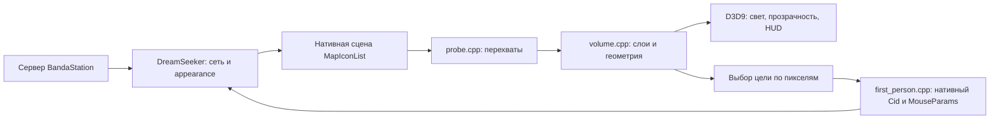

# Устройство мода

## Поток данных

Мод не подключается к игровому протоколу самостоятельно. Чтение полученных appearance и команды идут через настоящий DreamSeeker. Серверного дополнения у текущей версии нет.

## Границы модулей

- `launch.cpp`: создаёт отдельный DreamSeeker, проверяет адрес `LoadLibraryW` относительно модуля и загружает DLL. `win_handle.h` закрывает owned kernel handles на всех путях выхода. При таймауте удалённая строка пути остаётся в процессе до его завершения: поток загрузки ещё может читать её.
- `Start-NativeClient.ps1`: проверяет SHA из `compatibility.json`, формирует пути диагностики, вызывает launcher. Это поддерживаемая точка входа.
- `probe.cpp`: перехваты получения списка и драйвера, renderer/Present, сохранение сцены и диагностики. Оригинальные функции продолжают вызываться. Режим 3D определяется состоянием первого лица.
- `volume.cpp`: обход сцены, нормализация плоскостей/Z, кэш текстур, сборка составных appearance по Cid, классификация объектов, процедурная геометрия, освещение и выбор цели.
- `lighting_shader.h`: отдельный исходник D3D9 `ps_2_0`; использует нативную карту света и локальную коррекцию.
- `first_person.cpp`: захват/освобождение курсора, направление камеры, преобразование WASD в шаги сетки, клики и drag через нативные функции, hover.
- `compile_geometry.py` и `asset_utils.py`: анализ исходных DMI и генерация таблиц/пикселей. Во время игры распознавание использует таблицы, а не чтение дерева DMI с диска.

## ABI и бинарная привязка

`byond_abi.h` описывает только подтверждённое подмножество BYOND 516.1688 x86. Размер MapIcon — 216 байт. Ранее исследовалась 516.1663 с 208 байтами; декодер понимает старый формат дампа, но это не поддержка старого runtime.

Наблюдаемые поля: image/Cid, plane, color, координаты, transform, color matrix и диапазоны дочерних записей. Остальные байты не следует объявлять документированным API. В ряде мест смещения ещё находятся непосредственно в коде: работа по их полной типизации не завершена.

IAT-перехваты используют имена экспортов, часть D3D9 входов — проверенные RVA/vtable. Функции имеют x86 calling convention. Перенос на x64 или другой BYOND требует анализа заново, а не изменения одного размера структуры. `compatibility.json` хранит проверяемые SHA; `abi-516.1688.json` — исторический отчёт исследования, не автоматическое доказательство корректности всех полей.

## Appearance и геометрия

Обход сохраняет родительство и нормализует plane offsets. Составные части одного атома объединяются по Cid и плоскости; цвет и цветовые матрицы применяются при композитинге. Наследование класса между родителем и ребёнком ограничено одним Cid, чтобы содержимое контейнера не становилось корпусом контейнера.

Fingerprint считается FNV-1a по RGBA с обнулением RGB полностью прозрачных пикселей. Он идентифицирует кадр, а не DM-тип. Для некоторых greyscale-скамеек используется альфа-силуэт. Направленные приборы и большие двери могут заменять рисунок каноническим фронтальным кадром, сохраняя направление геометрии. Это сознательное визуальное преобразование.

Выбор цели проверяет видимые треугольники и альфа-канал. В BYOND передаются оригинальные идентификаторы и данные клика. Позиция картинки, перемещённая для удобства отображения, не должна подменять серверную координату предмета. Не все нестандартные преобразования и действия покрыты тестами.

## Владение и ограничения

Нативные указатели принадлежат BYOND. `OwnedScene` владеет копией массива записей, но не всем графом по внутренним указателям. GPU-текстуры хранятся в кэшах; временные поверхности/шейдеры освобождаются вручную. Смена устройства чистит часть кэшей. Полный RAII и потоковая изоляция renderer — дальнейшая работа, а не свойство текущей архитектуры.

Нет безопасной горячей выгрузки DLL. Игровые правила и авторитетная видимость остаются у сервера. Любая дополнительная геометрия, потолки и ambient — клиентские эвристики; их нельзя использовать как источник коллизий или прав доступа.
